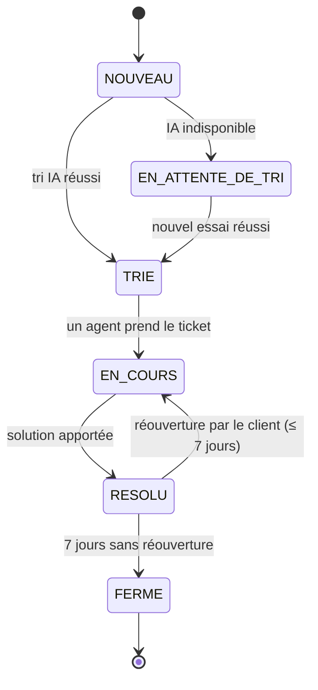
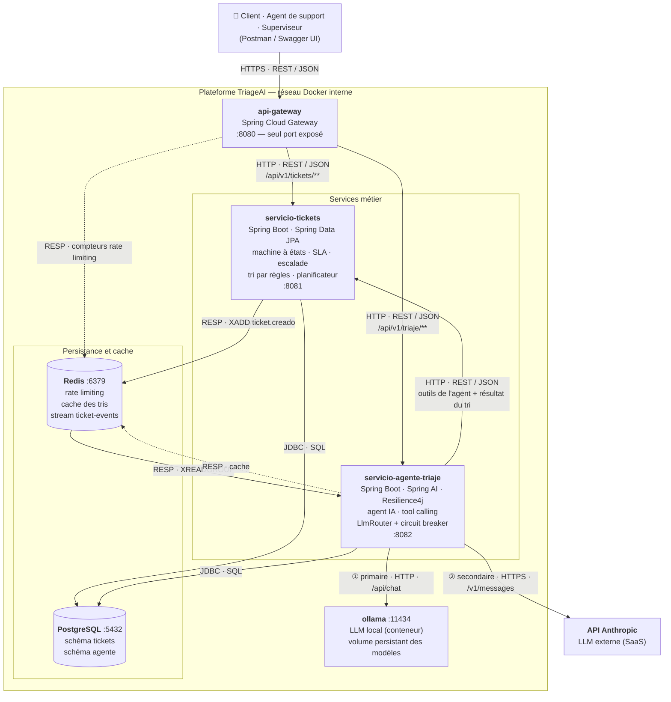
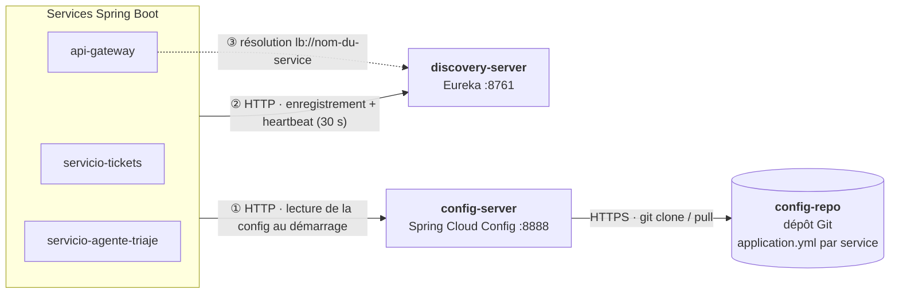
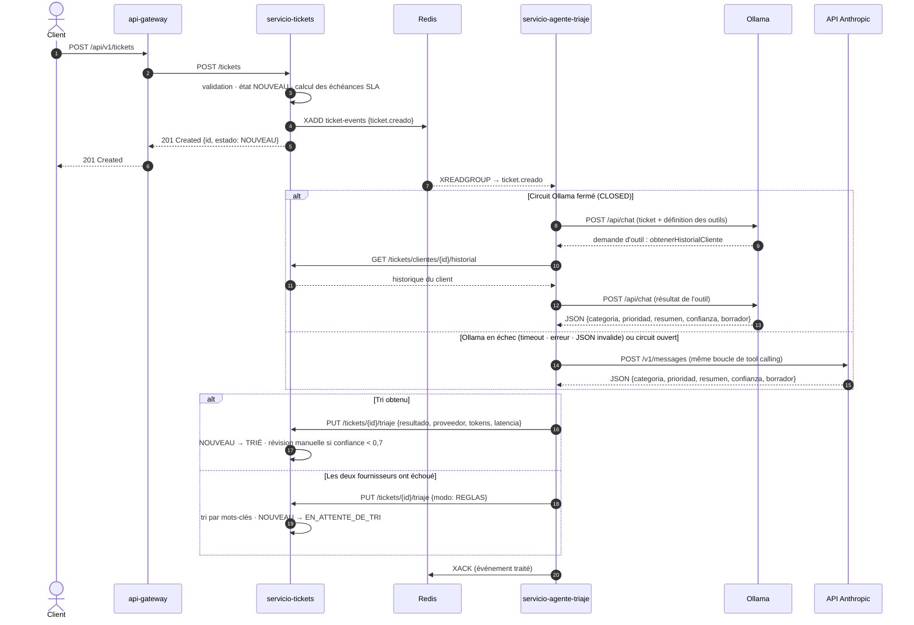

# TriageAI — Triage intelligent de tickets de support

> Projet de la matière **Cloud Computing: Fundamentos e Infraestructuras**
> Máster Universitario en Ingeniería Informática — ETSIIT, Universidad de Granada (curso 2026-27)

> ⚠️ **Brouillon de travail en français.** La version finale sera traduite (espagnol ou anglais) avant la remise du Hito 1.

---

## Table des matières

1. [Description du domaine](#1-description-du-domaine)
2. [Règles métier](#2-règles-métier)
3. [Cas d'utilisation](#3-cas-dutilisation)
4. [Justification NIST SP 800-145](#4-justification-nist-sp-800-145)
5. [Mapping des acteurs NIST SP 500-292](#5-mapping-des-acteurs-nist-sp-500-292)
6. [Architecture](#6-architecture)
7. [Spécification de l'API REST](#7-spécification-de-lapi-rest)
8. [Gestion du projet](#8-gestion-du-projet)
9. [État du projet](#9-état-du-projet)

---

## 1. Description du domaine

### 1.1 Le problème métier

Les équipes de support technique des PME reçoivent chaque jour un grand volume de demandes (*tickets*) : incidents, questions, réclamations. Aujourd'hui, **le tri de ces demandes est fait manuellement**, ce qui entraîne :

- **Perte de temps** : un agent humain doit lire chaque ticket pour en décider la catégorie et la priorité avant même de commencer à le résoudre.
- **Priorisation incohérente** : deux agents peuvent classer différemment le même problème ; un incident critique peut rester bloqué derrière des questions mineures.
- **Non-respect des délais** : les entreprises s'engagent sur des délais de réponse (*SLA*). Sans suivi automatique, ils sont dépassés sans que personne ne s'en aperçoive.
- **Réponses répétitives** : beaucoup de tickets concernent des problèmes déjà connus, mais chaque réponse est rédigée à partir de zéro.
- **Charge très irrégulière** : lors d'une panne ou d'un lancement de produit, le volume de tickets peut être multiplié par dix en quelques heures, puis redevenir normal.

### 1.2 La solution proposée

**TriageAI** est une application *cloud-native* basée sur des microservices qui automatise la première étape du support. À chaque nouveau ticket :

1. un **agent d'intelligence artificielle** analyse le texte, consulte l'historique du client (via un *outil*) et détermine la **catégorie**, la **priorité**, un **résumé** et un **niveau de confiance** ;
2. il propose un **brouillon de réponse** à l'agent humain ;
3. le système **suit automatiquement les délais SLA** et **escalade** les tickets à risque.

**Principes clés :**

- **Human-in-the-loop** : l'IA n'envoie jamais de réponse seule au client ; un agent humain valide toujours la proposition.
- **Résilience multi-fournisseur** : le système bascule automatiquement entre deux fournisseurs de LLM (**Ollama** en conteneur local ↔ **API Anthropic**), protégés par un *circuit breaker*.
- **Dégradation contrôlée** : si les deux fournisseurs sont indisponibles, un tri par **règles simples** est appliqué et le tri IA est relancé plus tard. Aucun ticket n'est jamais perdu.

### 1.3 Acteurs

| Acteur | Description |
|---|---|
| **Client** | Utilisateur final qui signale un problème et suit l'avancement de sa demande |
| **Agent de support** | Employé humain qui valide le tri, répond et résout les tickets |
| **Superviseur** | Responsable de l'équipe : surveille les délais, les escalades et les métriques |
| **Agent IA** | Composant automatique qui trie les tickets et propose des réponses |
| **Planificateur** (système) | Tâche automatique qui vérifie les SLA et relance les tris en attente |

---

## 2. Règles métier

Ces règles constituent la logique métier de l'application (au-delà d'un simple CRUD).

### RN-01 — Cycle de vie du ticket (machine à états)



- Seules les transitions représentées sont autorisées ; toute autre transition est refusée par l'API.
- Un ticket `RESOLU` peut être rouvert par le client pendant 7 jours, puis passe automatiquement à `FERME`.

### RN-02 — Délais SLA selon la priorité

| Priorité | Première réponse | Résolution |
|---|---|---|
| CRITIQUE | 1 h | 8 h |
| HAUTE | 4 h | 24 h |
| MOYENNE | 24 h | 3 jours |
| BASSE | 72 h | 7 jours |

Valeurs indicatives, **configurables** via le Config Server.

### RN-03 — Escalade automatique

Lorsqu'un ticket atteint **80 % de son délai SLA** sans réponse, il est marqué **« escaladé »** et le superviseur est alerté. L'escalade est un indicateur posé sur le ticket, pas un état.

### RN-04 — Seuil de confiance de l'IA

L'IA renvoie un niveau de confiance entre 0 et 1. En dessous de **0,7**, le ticket est marqué **« révision manuelle requise »**.

### RN-05 — Validation humaine obligatoire

Un brouillon de réponse généré par l'IA ne peut jamais être envoyé au client sans validation d'un agent de support.

### RN-06 — Basculement et dégradation contrôlée

1. Appel au fournisseur **primaire** (configurable, par défaut Ollama en local).
2. En cas d'échec (timeout, erreur de connexion, HTTP 401/403/429/5xx, JSON invalide) → fournisseur **secondaire** (Anthropic).
3. Un **circuit breaker** (états `CLOSED` / `OPEN` / `HALF_OPEN`) évite d'appeler un fournisseur déjà en panne.
4. Si les deux échouent → **tri par règles** (mots-clés), état `EN_ATTENTE_DE_TRI`, nouvel essai planifié.

### RN-07 — Traçabilité de l'IA

Chaque tri enregistre le **fournisseur utilisé**, le **nombre de tokens** consommés et le **temps de réponse**.

---

## 3. Cas d'utilisation

### 3.1 MVP

| Code | Cas d'utilisation | Acteur | Description | Règles |
|---|---|---|---|---|
| **CU-01** | Créer un ticket | Client | Le client décrit son problème (titre, description) | RN-01 |
| **CU-02** | Consulter ses tickets | Client | Voir l'état et l'historique de ses demandes | — |
| **CU-03** | Trier automatiquement un ticket | Agent IA | Catégorie, priorité, résumé, confiance et brouillon de réponse, en consultant l'historique du client | RN-04, RN-06, RN-07 |
| **CU-04** | Valider le tri et répondre | Agent de support | Consulter la proposition de l'IA, la corriger si besoin, envoyer la réponse | RN-05 |
| **CU-05** | Changer l'état d'un ticket | Agent de support | Faire avancer le ticket dans son cycle de vie | RN-01 |
| **CU-06** | Surveiller les SLA et escalader | Planificateur | Vérifier les délais et marquer les tickets à risque | RN-02, RN-03 |
| **CU-07** | Relancer les tris en attente | Planificateur | Retenter le tri IA des tickets `EN_ATTENTE_DE_TRI` | RN-06 |

### 3.2 Extensions (optionnelles)

| Code | Cas d'utilisation | Acteur |
|---|---|---|
| **CU-08** | Consulter les métriques (tickets par état, respect des SLA, consommation par fournisseur LLM) | Superviseur |
| **CU-09** | Rouvrir un ticket résolu | Client |
| **CU-10** | Configurer les délais SLA | Superviseur |

### 3.3 Hors périmètre

- Réception de tickets par e-mail, chat ou réseaux sociaux (l'API REST suffit).
- Gestion avancée des comptes et des droits.
- Interface web complète (Swagger UI / Postman pour les démonstrations).

---

## 4. Justification NIST SP 800-145

> 🚧 *À rédiger* — analyse des 5 caractéristiques essentielles : autoservice à la demande, large accès réseau, mutualisation des ressources, élasticité rapide, service mesuré.

## 5. Mapping des acteurs NIST SP 500-292

> 🚧 *À rédiger* — rôles Consommateur, Fournisseur, Courtier, Auditeur, Opérateur (*Carrier*), avec analyse de l'impact économique.

## 6. Architecture

### 6.1 Style et principes architecturaux

TriageAI suit une **architecture de microservices** (*arquitectura de microservicios*) orientée cloud-native :

| Principe | Application dans TriageAI |
|---|---|
| **Découpage par responsabilité métier** | Un service pour le cycle de vie des tickets, un service pour l'agent IA |
| **Point d'entrée unique** (*API Gateway*) | Seul le gateway est exposé à l'extérieur ; les autres services restent sur le réseau interne |
| **Services sans état** (*stateless*) | Aucun état en mémoire : les données vivent dans PostgreSQL et Redis, ce qui permet de répliquer les services |
| **Base de données par service** (*database per service*) | Chaque service possède son propre schéma ; aucun service ne lit les tables d'un autre |
| **Communication asynchrone pour les tâches lentes** | Le tri IA (plusieurs secondes) est déclenché par un événement, pas par un appel bloquant |
| **Configuration externalisée** | Ordre des fournisseurs LLM, timeouts, délais SLA : lus depuis le Config Server, modifiables sans recompiler |
| **Conception pour la défaillance** (*design for failure*) | Circuit breaker, basculement entre fournisseurs LLM, dégradation contrôlée par règles |

### 6.2 Diagramme de composants



> Le **plan de contrôle** (découverte de services et configuration) est représenté séparément en 6.3 pour garder ce diagramme lisible.

### 6.3 Plan de contrôle : découverte et configuration



**Ordre de démarrage :** `config-server` → `discovery-server` → `servicio-tickets` / `servicio-agente-triaje` → `api-gateway`.

**Exemples de propriétés centralisées :**

```yaml
# config-repo/servicio-agente-triaje.yml
llm:
  proveedor-primario: ollama        # anthropic en production
  proveedor-secundario: anthropic
  timeout-segundos: 60
  umbral-confianza: 0.7             # RN-04
resilience4j.circuitbreaker.instances:
  ollama:    { failureRateThreshold: 50, waitDurationInOpenState: 60s }
  anthropic: { failureRateThreshold: 50, waitDurationInOpenState: 60s }
```

### 6.4 Flux principal : création et tri d'un ticket



**Pourquoi un tri asynchrone ?** Un appel LLM peut prendre de 2 à 60 secondes. Le client reçoit immédiatement `201 Created` ; le tri se fait en arrière-plan. Si `servicio-agente-triaje` est arrêté, les événements restent dans le stream Redis et seront traités à son redémarrage : **aucun ticket n'est perdu**.

### 6.5 Catalogue des composants

| Composant | Type | Technologie | Port | Exposé | Responsabilité |
|---|---|---|---|---|---|
| `api-gateway` | Infrastructure | Spring Cloud Gateway | 8080 | ✅ | Routage, rate limiting, point d'entrée unique |
| `discovery-server` | Infrastructure | Spring Cloud Netflix Eureka | 8761 | ❌ | Registre de services |
| `config-server` | Infrastructure | Spring Cloud Config | 8888 | ❌ | Configuration centralisée depuis Git |
| `servicio-tickets` | Métier | Spring Boot, Spring Data JPA | 8081 | ❌ | Cycle de vie, SLA, escalade, tri par règles, tâches planifiées |
| `servicio-agente-triaje` | Métier | Spring Boot, Spring AI, Resilience4j | 8082 | ❌ | Agent IA, tool calling, routage et basculement LLM |
| `postgres` | Données | PostgreSQL | 5432 | ❌ | Persistance relationnelle |
| `redis` | Données | Redis | 6379 | ❌ | Cache, rate limiting, bus d'événements (Streams) |
| `ollama` | IA | Ollama | 11434 | ❌ | Inférence LLM locale |
| API Anthropic | IA externe | SaaS | 443 | — | Inférence LLM de secours |

### 6.6 Protocoles de communication

| Source → Destination | Protocole | Mode | Format | Usage |
|---|---|---|---|---|
| Client → `api-gateway` | HTTPS | Synchrone | REST / JSON | Toutes les requêtes externes |
| `api-gateway` → services métier | HTTP | Synchrone | REST / JSON | Routage via `lb://` (Eureka) |
| `servicio-tickets` → Redis Streams | RESP | **Asynchrone** | Événement JSON | Publication de `ticket.creado` |
| Redis Streams → `servicio-agente-triaje` | RESP | **Asynchrone** | Événement JSON | Consommation par groupe de consommateurs |
| `servicio-agente-triaje` → `servicio-tickets` | HTTP | Synchrone | REST / JSON | Outils de l'agent + enregistrement du tri |
| `servicio-agente-triaje` → Ollama | HTTP | Synchrone | JSON (`/api/chat`) | Inférence primaire |
| `servicio-agente-triaje` → Anthropic | HTTPS | Synchrone | JSON (Messages API) | Inférence secondaire |
| Services → PostgreSQL | JDBC | Synchrone | SQL | Persistance |
| Services → `config-server` | HTTP | Au démarrage | JSON / YAML | Lecture de la configuration |
| Services → `discovery-server` | HTTP | Périodique | JSON | Enregistrement et heartbeat |

### 6.7 Stockage des données

| Stockage | Propriétaire | Contenu principal | Persistance |
|---|---|---|---|
| PostgreSQL — schéma `tickets` | `servicio-tickets` | `ticket`, `historial_estado`, `triaje`, `respuesta` | Permanente (volume Docker) |
| PostgreSQL — schéma `agente` | `servicio-agente-triaje` | `llamada_llm` : fournisseur, modèle, tokens, latence, succès/échec (RN-07) | Permanente (volume Docker) |
| Redis — `ticket-events` | `servicio-tickets` (producteur) | Événements `ticket.creado` | Jusqu'à acquittement (`XACK`) |
| Redis — cache des tris | `servicio-agente-triaje` | Résultat du tri indexé par empreinte du texte (doublons, ex. panne massive) | Temporaire (TTL) |
| Redis — rate limiting | `api-gateway` | Compteurs de requêtes par client | Temporaire |
| Volume `ollama-models` | `ollama` | Poids des modèles téléchargés | Permanente |

> Une seule instance PostgreSQL avec **un schéma par service** : l'isolation logique respecte le principe *database per service* tout en limitant la consommation de ressources.

### 6.8 Résilience et sécurité

| Aspect | Mesure |
|---|---|
| Panne d'un fournisseur LLM | Circuit breaker Resilience4j par fournisseur (`CLOSED` → `OPEN` → `HALF_OPEN`) + timeout configurable |
| Panne des deux fournisseurs | Tri par règles + état `EN_ATTENTE_DE_TRI` + nouvel essai planifié (RN-06) |
| Panne du service agent | Événements conservés dans le stream Redis jusqu'au redémarrage |
| Surcharge / abus | Rate limiting au gateway (Redis) |
| Secrets | `ANTHROPIC_API_KEY` et mots de passe en variables d'environnement, jamais dans Git (`.env` dans `.gitignore`) |
| Surface d'exposition | Seul `api-gateway` publie un port ; les autres services sont uniquement sur le réseau interne |
| Supervision | Spring Boot Actuator (`/actuator/health`) sur chaque service — base de l'observabilité du Hito 5 |

### 6.9 Décisions d'architecture

| Décision | Alternatives considérées | Justification |
|---|---|---|
| **Redis Streams** comme bus d'événements | RabbitMQ, Kafka | Redis est déjà présent (cache, rate limiting) : un composant de moins à exploiter ; volume d'événements modeste |
| **Un PostgreSQL, un schéma par service** | Une instance par service | Isolation logique suffisante pour le projet, consommation mémoire réduite |
| **Tri asynchrone** | Appel REST synchrone gateway → agent | Latence LLM élevée et variable ; absorbe les pics de tickets |
| **Eureka + Config Server** | Découverte et configuration natives de Kubernetes | Indépendant de la plateforme de déploiement ; à réévaluer au Hito 3 (Spring Cloud Kubernetes) |
| **Deux fournisseurs LLM** | Un seul fournisseur | Continuité de service et maîtrise des coûts (local gratuit / API payante à l'usage) |

## 7. Spécification de l'API REST

> 🚧 *À rédiger* — routes, verbes HTTP et payloads JSON.

## 8. Gestion du projet

> 🚧 *À compléter* — stratégie de branches, convention de commits, GitHub Projects, user stories, templates.

## 9. État du projet

| Hito | Contenu | État |
|---|---|---|
| Hito 1 | Définition, modèle métier, architecture de référence | 🟡 En cours |
| Hito 2 | Empaquetage cloud native, environnement local, CI | ⚪ |
| Hito 3 | Provisionnement IaC, Reconciler Pattern | ⚪ |
| Hito 4 | Déploiement continu, réconciliation, sécurité | ⚪ |
| Hito 5 | Observabilité, tests de charge, release finale | ⚪ |
