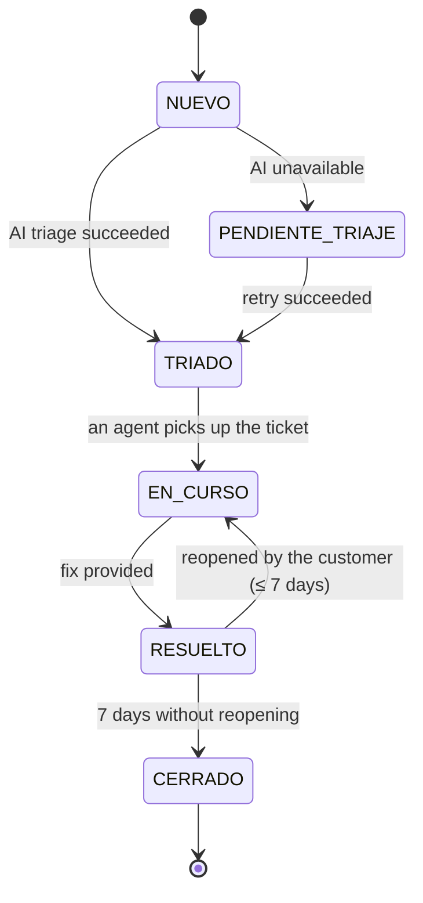
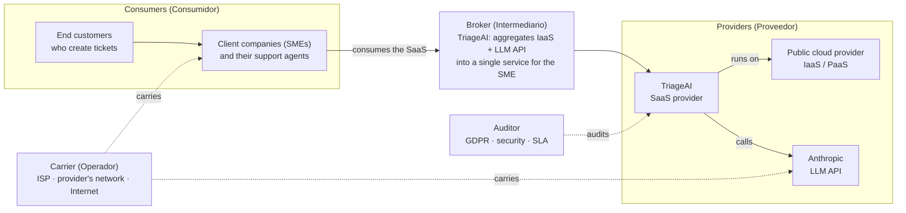
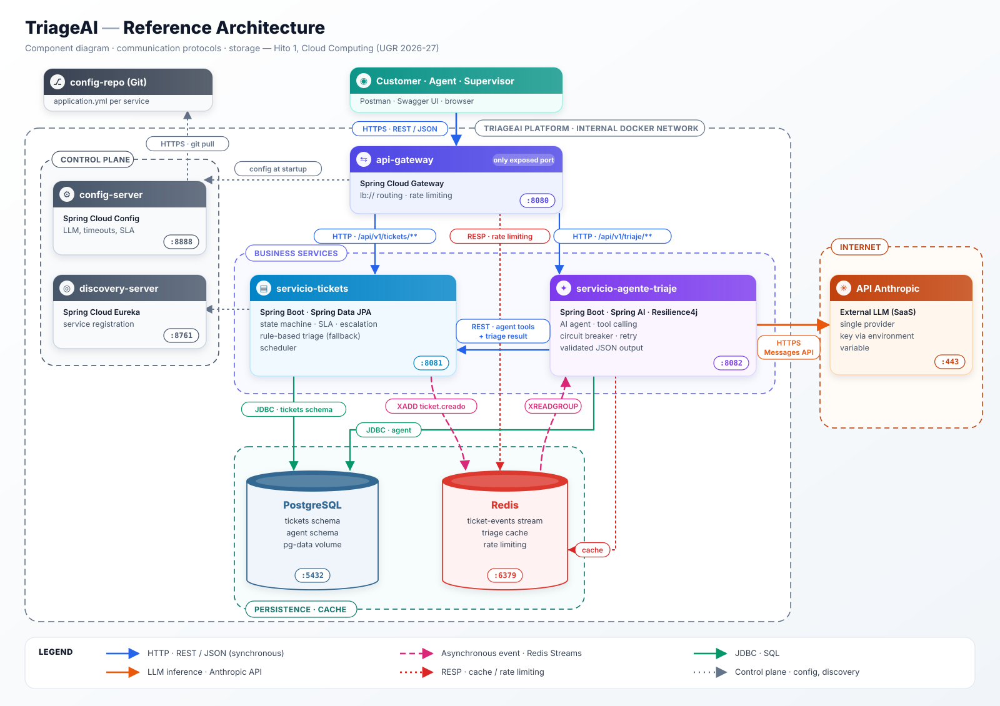
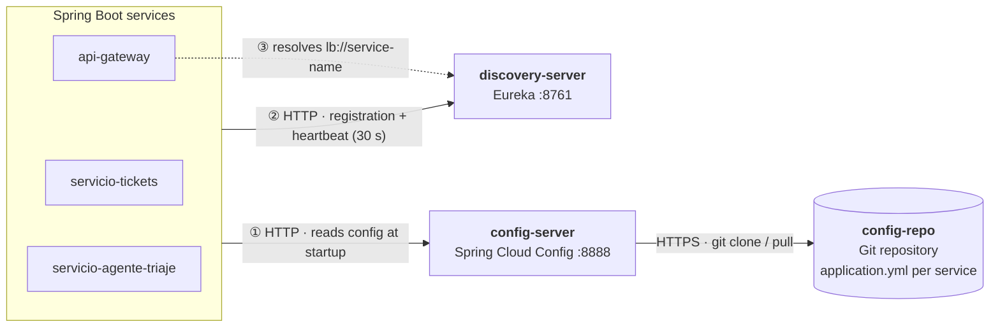
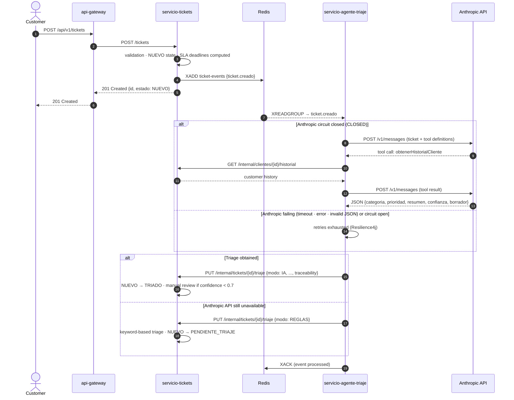

# TriageAI — Intelligent Support Ticket Triage

> Project for the course **Cloud Computing: Fundamentos e Infraestructuras**
> Máster Universitario en Ingeniería Informática — ETSIIT, Universidad de Granada (2026-27)

---

## Table of contents

1. [Domain description](#1-domain-description)
2. [Business rules](#2-business-rules)
3. [Use cases](#3-use-cases)
4. [NIST SP 800-145 justification](#4-nist-sp-800-145-justification)
5. [NIST SP 500-292 actor mapping](#5-nist-sp-500-292-actor-mapping)
6. [Architecture](#6-architecture)
7. [REST API specification](#7-rest-api-specification)
8. [Project management](#8-project-management)
9. [Project status](#9-project-status)

---

## 1. Domain description

### 1.1 The business problem

Technical support teams at SMEs receive a large volume of requests (*tickets*) every day: incidents, questions, complaints. Today, **triaging these requests is done manually**, which causes:

- **Wasted time**: a human agent has to read every ticket just to decide its category and priority before even starting to resolve it.
- **Inconsistent prioritization**: two agents may classify the same problem differently; a critical incident can stay stuck behind minor questions.
- **Missed deadlines**: companies commit to response times (*SLAs*). Without automatic tracking, they are missed without anyone noticing.
- **Repetitive answers**: many tickets concern already-known problems, yet every reply is written from scratch.
- **Highly irregular load**: during an outage or a product launch, ticket volume can multiply tenfold within hours, then return to normal.

### 1.2 The proposed solution

**TriageAI** is a *cloud-native* microservices application that automates the first step of support. For every new ticket:

1. an **AI agent** analyzes the text, looks up the customer's history (via a *tool*) and determines the **category**, the **priority**, a **summary** and a **confidence level**;
2. it proposes a **draft reply** to the human agent;
3. the system **automatically tracks SLA deadlines** and **escalates** at-risk tickets.

**Key principles:**

- **Human-in-the-loop**: the AI never sends a reply to the customer on its own; a human agent always validates the proposal.
- **Resilience against the external AI**: the agent calls the **Anthropic API**, protected by a *circuit breaker* (timeouts, errors, rate limits).
- **Graceful degradation**: if the Anthropic API is unavailable, a **rule-based** fallback triage is applied and the AI triage is retried later. No ticket is ever lost.

### 1.3 Actors

| Actor | Description |
|---|---|
| **Customer** | End user who reports a problem and tracks the progress of their request |
| **Support agent** | Human employee who validates the triage, replies to and resolves tickets |
| **Supervisor** | Team lead: monitors deadlines, escalations and metrics |
| **AI agent** | Automated component that triages tickets and proposes replies |
| **Scheduler** (system) | Automated job that checks SLAs and retries pending triages |

---

## 2. Business rules

These rules form the business logic of the application (beyond plain CRUD).

### RN-01 — Ticket lifecycle (state machine)



- Only the transitions shown are allowed; any other transition is rejected by the API.
- A `RESUELTO` ticket can be reopened by the customer for 7 days, after which it automatically moves to `CERRADO`.

### RN-02 — SLA deadlines by priority

| Priority | First response | Resolution |
|---|---|---|
| CRITICA | 1 h | 8 h |
| ALTA | 4 h | 24 h |
| MEDIA | 24 h | 3 days |
| BAJA | 72 h | 7 days |

Indicative values, **configurable** through the Config Server.

### RN-03 — Automatic escalation

When a ticket reaches **80% of its SLA deadline** without a response, it is marked **"escalated"** and the supervisor is alerted. Escalation is a flag set on the ticket, not a state.

### RN-04 — AI confidence threshold

The AI returns a confidence level between 0 and 1. Below **0.7**, the ticket is marked **"manual review required"**.

### RN-05 — Mandatory human validation

An AI-generated draft reply can never be sent to the customer without validation from a support agent.

### RN-06 — Resilience and graceful degradation

1. Call to the **Anthropic API** (via Spring AI).
2. On failure (timeout, connection error, HTTP 401/403/429/5xx, invalid JSON) → retry according to the `Resilience4j` policy (bounded retry).
3. A **circuit breaker** (`CLOSED` / `OPEN` / `HALF_OPEN` states) avoids hammering the API when it is already down or rate-limited.
4. If the call still fails (circuit `OPEN` or repeated failures) → **rule-based triage** (keywords), `PENDIENTE_TRIAJE` state, retry scheduled.

### RN-07 — AI traceability

Every triage records the **provider used**, the **number of tokens** consumed and the **response time**.

---

## 3. Use cases

### 3.1 MVP

| Code | Use case | Actor | Description | Rules |
|---|---|---|---|---|
| **CU-01** | Create a ticket | Customer | The customer describes their problem (title, description) | RN-01 |
| **CU-02** | View own tickets | Customer | See the status and history of their requests | — |
| **CU-03** | Automatically triage a ticket | AI agent | Category, priority, summary, confidence and draft reply, by looking up the customer's history | RN-04, RN-06, RN-07 |
| **CU-04** | Validate the triage and reply | Support agent | Review the AI's proposal, correct it if needed, send the reply | RN-05 |
| **CU-05** | Change a ticket's state | Support agent | Move the ticket forward in its lifecycle | RN-01 |
| **CU-06** | Monitor SLAs and escalate | Scheduler | Check deadlines and flag at-risk tickets | RN-02, RN-03 |
| **CU-07** | Retry pending triages | Scheduler | Retry AI triage for tickets in `PENDIENTE_TRIAJE` | RN-06 |

### 3.2 Extensions (optional)

| Code | Use case | Actor |
|---|---|---|
| **CU-08** | View metrics (tickets by state, SLA compliance, consumption per LLM provider) | Supervisor |
| **CU-09** | Reopen a resolved ticket | Customer |
| **CU-10** | Configure SLA deadlines | Supervisor |

### 3.3 Out of scope

- Receiving tickets by email, chat or social media (the REST API is sufficient).
- Advanced account and permission management.
- A full web interface (Swagger UI / Postman for demonstrations).

---

## 4. NIST SP 800-145 justification

> Reference: P. Mell, T. Grance, *The NIST Definition of Cloud Computing*, NIST SP 800-145, 2011. https://doi.org/10.6028/NIST.SP.800-145

NIST defines cloud computing through **5 essential characteristics**. This section shows how TriageAI leverages each of them and why the business problem (section 1) **needs** the cloud.

### 4.1 Summary

| NIST characteristic | TriageAI's business need | Technical mechanism | Hito where it will be demonstrated |
|---|---|---|---|
| **On-demand self-service** | Add capacity or an environment without human intervention from the provider | Infrastructure as code (IaC), externalized configuration | Hito 3, Hito 4 |
| **Broad network access** | Customers and support agents are spread out, on any kind of device | REST API over HTTPS through a single entry point | Hito 1 (API), Hito 4 (deployment) |
| **Resource pooling** | Serve several client companies with the same platform | Multi-tenant model, physical resources shared by the provider | Hito 3 |
| **Rapid elasticity** | Absorb ×10 ticket spikes during an outage or a launch | Stateless, replicable services, Redis Streams event queue | Hito 2, Hito 5 (load testing) |
| **Measured service** | Know and control the cost of every AI-triaged ticket | Token and latency traceability (RN-07), Actuator metrics | Hito 1 (design), Hito 5 (observability) |

### 4.2 On-demand self-service

**NIST definition (summarized):** a consumer can unilaterally provision computing capabilities (servers, storage…) automatically, **without human interaction** with the provider.

**Application to TriageAI:**

- All infrastructure (containers, network, database, cache) will be described as code and created with a single command, with no ticket filed to an administrator (Hito 3).
- A whole new environment (test, demo, production) can be obtained on demand from the same files.
- On the AI side, access to the Anthropic API is self-service: create a key and pay per use, with no contract or hardware.
- Business parameters (SLA deadlines, LLM provider order, confidence threshold) are changed in the configuration repository, with no code redeployment.

### 4.3 Broad network access

**NIST definition (summarized):** capabilities are available over the network and accessed through standard mechanisms, from heterogeneous clients (computers, phones, tablets…).

**Application to TriageAI:**

- All functionality is exposed through a **standard REST API** (HTTP, JSON, OpenAPI) behind `api-gateway`: any client (web app, mobile app, internal tool, integration from another system) can use it.
- Customers report problems from anywhere; support agents can work remotely.
- The API contract is documented and versioned (`/api/v1`), which makes third-party integration easier.

### 4.4 Resource pooling

**NIST definition (summarized):** the provider's resources are pooled to serve multiple consumers in a **multi-tenant model**, and dynamically reassigned according to demand. The consumer has no knowledge of the exact location of the resources.

**Application to TriageAI:**

- **On the cloud provider's side:** TriageAI's containers run on physical infrastructure shared with the provider's other customers; TriageAI manages neither servers nor a data center.
- **On TriageAI's side:** the platform is designed to serve **several client companies** (SMEs) with the same service instances, the same database and the same cache. The separation is logical (a customer ID on every ticket), not physical.
- **On the AI side:** the Anthropic API is itself a pooled service shared among many consumers; TriageAI only pays for the share it uses.

### 4.5 Rapid elasticity

**NIST definition (summarized):** capabilities can be scaled up or down quickly, sometimes automatically, according to demand. To the consumer, they appear unlimited.

**Application to TriageAI:** this is the most important characteristic for the project, since support load is **highly irregular** (section 1.1).

- **Stateless services:** `servicio-tickets` and `servicio-agente-triaje` keep no data in memory, so 1, 3 or 10 replicas can be run depending on load.
- **Event queue:** during a spike, tickets are recorded immediately and `ticket.creado` events pile up in Redis Streams. The AI agent's replicas, members of the same consumer group, **share the work** automatically.
- **Elasticity signal:** the length of the `ticket-events` stream is a natural metric for triggering the addition or removal of replicas.
- **AI-side elasticity:** the Anthropic API is itself a managed, elastic service on the provider's side; the Redis cache and rate limiting avoid paying twice for an identical triage during a spike (e.g. a massive outage reported by many customers).

**Illustration (figures used for the sake of example):** a normal load needs 1 AI-agent replica, and a spike needs 10, for 5% of the time.

| Approach | Capacity paid for | Equivalent machine-years |
|---|---|---|
| Own servers sized for the peak | 10 replicas at all times | 10 |
| Elastic cloud | 1 replica × 95% + 10 replicas × 5% | **1.45** |

In this example, elasticity cuts the capacity paid for by roughly **85%**. Real figures will be measured during Hito 5's load tests.

### 4.6 Measured service

**NIST definition (summarized):** resource usage is automatically **measured, controlled and reported**, which ensures transparency for both the provider and the consumer (pay-per-use).

**Application to TriageAI:**

- **AI measurement (RN-07):** every LLM call records the provider, the model, input and output tokens, latency and the outcome (`llamada_llm` table). The **cost of every triaged ticket** can therefore be computed.
- **Infrastructure measurement:** every service exposes its metrics (Spring Boot Actuator, Micrometer): requests, errors, response times, memory consumption.
- **Control:** gateway rate limiting and the Redis triage cache limit the number of paid API calls.
- **Reporting:** the `GET /api/v1/triaje/metricas` endpoint (CU-08) reports consumption (tokens, latency, failure rate) over a period. It will serve as the basis for **per-ticket billing** of client companies.

### 4.7 Service and deployment models

NIST SP 800-145 also defines service and deployment models. TriageAI positions itself as follows:

| Viewpoint | Model |
|---|---|
| TriageAI as seen by client companies | **SaaS** (*Software as a Service*): a complete application consumed through the API |
| What TriageAI consumes to run | **IaaS / PaaS** from a public cloud provider (to be chosen in Hito 3) |
| What TriageAI consumes for AI | **SaaS / API**: Anthropic's language model, billed per use |
| Deployment model | **Public cloud** |

---

## 5. NIST SP 500-292 actor mapping

> Reference: F. Liu et al., *NIST Cloud Computing Reference Architecture*, NIST SP 500-292, 2011. https://doi.org/10.6028/NIST.SP.500-292

NIST's reference architecture defines **5 actors**. For TriageAI, two levels must be distinguished: TriageAI **provides** a service to companies, and TriageAI itself **consumes** cloud services.

### 5.1 Overview



### 5.2 Role breakdown

| NIST role | Actor(s) in TriageAI | Activities in the project | Economic impact |
|---|---|---|---|
| **Consumer** (*Cloud Consumer*) | ① The **client companies** (SMEs) and their support agents, who consume TriageAI as SaaS. ② **The TriageAI team**, who consumes IaaS/PaaS and the Anthropic API | Using the API, validating triages, tracking SLAs; for the TriageAI team: deploying and paying for the resources consumed | SMEs move from a **fixed cost** (agents triaging by hand) to a **variable, per-ticket cost**; the TriageAI team has **no hardware investment** (CapEx → OpEx) |
| **Provider** (*Cloud Provider*) | ① **TriageAI** (SaaS provider). ② The **public cloud provider** (IaaS/PaaS, to be chosen in Hito 3). ③ **Anthropic** (LLM API) | TriageAI: deployment, orchestration, service management, security and confidentiality of ticket data. Cloud provider: compute, storage, network. Anthropic: model inference | TriageAI is paid **per processed ticket** or by subscription; its costs are infrastructure + tokens. The cloud provider and Anthropic bill **per use** (compute hours, tokens) |
| **Broker** (*Cloud Broker*) | **TriageAI itself**, from the client companies' point of view: the platform aggregates the cloud provider (IaaS/PaaS) and the Anthropic API into **a single service billed once**. NIST SP 500-292 explicitly allows the same actor to hold both the provider and broker roles | **Service aggregation**: the SME has neither a cloud account nor an Anthropic API key to manage. **Technical intermediation**: the `AnthropicClient` component in `servicio-agente-triaje` wraps the LLM call behind a circuit breaker and a cache, and remains designed to accommodate a second provider if needed (see 6.9) | Simplifies the offering for the SME (**a single contract, a single invoice**); the Redis cache avoids paying twice for an identical triage |
| **Auditor** (*Cloud Auditor*) | An **independent external auditor**: a data protection officer, a security audit firm, or the client company checking SLAs | **Privacy audit**: tickets contain personal data (GDPR, and in Spain the LOPDGDD); data is sent to an external API. **Security audit**: secrets management, exposure surface. **Performance audit**: SLA compliance and escalation rate | **Built-in traceability** (state history, RN-07, metrics) lowers the cost of an audit; compliance avoids penalties and reassures customers |
| **Carrier** (*Cloud Carrier*) | Customers' **Internet service providers**, the **cloud provider's network**, and the Internet between the platform and the Anthropic API | Carrying HTTPS requests between customers and `api-gateway`, and between `servicio-agente-triaje` and Anthropic | Cost of **outbound traffic** (*egress*) billed by the cloud provider; network latency adds to the LLM's own latency. Compact JSON payloads and the cache limit this traffic |

### 5.3 Economic impact analysis

**1. From CapEx to OpEx**
No servers or GPUs are purchased: all resources are rented and paid per use. The financial risk at service launch is therefore low.

**2. Cost of a triaged ticket** — measured service (section 4.6) makes it computable:

```
Cost per ticket = LLM cost + Infrastructure cost / number of tickets

LLM cost (Anthropic) = input_tokens × input_price + output_tokens × output_price
```

Unit prices will be taken from the official pricing pages at deployment time; token volumes will be measured through RN-07.

**3. Cost-reduction levers built into the architecture**

| Lever | Effect |
|---|---|
| Redis triage cache | An identical ticket (e.g. a massive outage) is only paid for once |
| Elasticity (section 4.5) | Peak capacity is only paid for during spikes |
| Gateway rate limiting | Prevents a single client from exhausting the API budget |
| Rule-based triage as a last resort | The service keeps running at zero AI cost |

**4. Return on investment for client companies**
If a human agent spends *t* minutes on average triaging a ticket, the monthly saving is roughly `tickets_per_month × t × agent_hourly_cost / 60`, to be compared against the price paid to TriageAI. Human validation remains mandatory (RN-05), but it is faster than a full triage.

## 6. Architecture

### 6.1 Architectural style and principles

TriageAI follows a **microservices architecture** oriented toward cloud-native design:

| Principle | Application in TriageAI |
|---|---|
| **Decomposition by business responsibility** | One service for the ticket lifecycle, one service for the AI agent |
| **Single entry point** (*API Gateway*) | Only the gateway is exposed externally; the other services stay on the internal network |
| **Stateless services** | No in-memory state: data lives in PostgreSQL and Redis, which allows services to be replicated |
| **Database per service** | Each service owns its own schema; no service reads another service's tables |
| **Asynchronous communication for slow tasks** | AI triage (several seconds) is triggered by an event, not a blocking call |
| **Externalized configuration** | Timeouts, confidence threshold, SLA deadlines: read from the Config Server, changeable without recompiling |
| **Design for failure** | Circuit breaker on the call to Anthropic, graceful rule-based degradation |

### 6.2 Component diagram



> The **control plane** (service discovery and configuration) is shown separately in 6.3 to keep this diagram readable.

### 6.3 Control plane: discovery and configuration



**Startup order:** `config-server` → `discovery-server` → `servicio-tickets` / `servicio-agente-triaje` → `api-gateway`.

**Examples of centralized properties:**

```yaml
# config-repo/servicio-agente-triaje.yml
llm:
  proveedor: anthropic
  modelo: <configured model>
  timeout-segundos: 60
  umbral-confianza: 0.7             # RN-04
resilience4j.circuitbreaker.instances:
  anthropic: { failureRateThreshold: 50, waitDurationInOpenState: 60s }
```

### 6.4 Main flow: creating and triaging a ticket



**Why asynchronous triage?** An LLM call can take anywhere from 2 to 60 seconds. The customer immediately receives `201 Created`; triage happens in the background. If `servicio-agente-triaje` is down, events stay in the Redis stream and are processed once it restarts: **no ticket is ever lost**.

### 6.5 Component catalog

| Component | Type | Technology | Port | Exposed | Responsibility |
|---|---|---|---|---|---|
| `api-gateway` | Infrastructure | Spring Cloud Gateway | 8080 | ✅ | Routing, rate limiting, single entry point |
| `discovery-server` | Infrastructure | Spring Cloud Netflix Eureka | 8761 | ❌ | Service registry |
| `config-server` | Infrastructure | Spring Cloud Config | 8888 | ❌ | Centralized configuration from Git |
| `servicio-tickets` | Business | Spring Boot, Spring Data JPA | 8081 | ❌ | Lifecycle, SLA, escalation, rule-based triage, scheduled jobs |
| `servicio-agente-triaje` | Business | Spring Boot, Spring AI, Resilience4j | 8082 | ❌ | AI agent, tool calling, resilience against the LLM API |
| `postgres` | Data | PostgreSQL | 5432 | ❌ | Relational persistence |
| `redis` | Data | Redis | 6379 | ❌ | Cache, rate limiting, event bus (Streams) |
| Anthropic API | External AI | SaaS | 443 | — | LLM inference |

### 6.6 Communication protocols

| Source → Destination | Protocol | Mode | Format | Usage |
|---|---|---|---|---|
| Customer → `api-gateway` | HTTPS | Synchronous | REST / JSON | All external requests |
| `api-gateway` → business services | HTTP | Synchronous | REST / JSON | Routing via `lb://` (Eureka) |
| `servicio-tickets` → Redis Streams | RESP | **Asynchronous** | JSON event | Publishing `ticket.creado` |
| Redis Streams → `servicio-agente-triaje` | RESP | **Asynchronous** | JSON event | Consumed by consumer group |
| `servicio-agente-triaje` → `servicio-tickets` | HTTP | Synchronous | REST / JSON | Agent tools + recording the triage |
| `servicio-agente-triaje` → Anthropic | HTTPS | Synchronous | JSON (Messages API) | Triage inference |
| Services → PostgreSQL | JDBC | Synchronous | SQL | Persistence |
| Services → `config-server` | HTTP | At startup | JSON / YAML | Reading configuration |
| Services → `discovery-server` | HTTP | Periodic | JSON | Registration and heartbeat |

### 6.7 Data storage

| Storage | Owner | Main content | Persistence |
|---|---|---|---|
| PostgreSQL — `tickets` schema | `servicio-tickets` | `ticket`, `historial_estado`, `triaje`, `respuesta` | Permanent (Docker volume) |
| PostgreSQL — `agente` schema | `servicio-agente-triaje` | `llamada_llm`: provider, model, tokens, latency, success/failure (RN-07) | Permanent (Docker volume) |
| Redis — `ticket-events` | `servicio-tickets` (producer) | `ticket.creado` events | Until acknowledged (`XACK`) |
| Redis — triage cache | `servicio-agente-triaje` | Triage result indexed by a text fingerprint (duplicates, e.g. a mass outage) | Temporary (TTL) |
| Redis — rate limiting | `api-gateway` | Per-client request counters | Temporary |

> A single PostgreSQL instance with **one schema per service**: logical isolation respects the *database per service* principle while limiting resource consumption.

### 6.8 Resilience and security

| Aspect | Measure |
|---|---|
| Anthropic API outage | Resilience4j circuit breaker (`CLOSED` → `OPEN` → `HALF_OPEN`) + configurable timeout and retry |
| Persistent AI outage | Rule-based triage + `PENDIENTE_TRIAJE` state + scheduled retry (RN-06) |
| Agent service outage | Events kept in the Redis stream until restart |
| Overload / abuse | Rate limiting at the gateway (Redis) |
| Secrets | `ANTHROPIC_API_KEY` and passwords as environment variables, never in Git (`.env` in `.gitignore`) |
| Exposure surface | Only `api-gateway` publishes a port; the other services are reachable only on the internal network |
| Monitoring | Spring Boot Actuator (`/actuator/health`) on every service — the basis for Hito 5's observability |

### 6.9 Architecture decisions

| Decision | Alternatives considered | Rationale |
|---|---|---|
| **Redis Streams** as the event bus | RabbitMQ, Kafka | Redis is already present (cache, rate limiting): one fewer component to operate; modest event volume |
| **One PostgreSQL instance, one schema per service** | One instance per service | Logical isolation is sufficient for the project, lower memory footprint |
| **Asynchronous triage** | Synchronous REST call gateway → agent | LLM latency is high and variable; absorbs ticket spikes |
| **Eureka + Config Server** | Kubernetes-native discovery and configuration | Independent of the deployment platform; to be reassessed in Hito 3 (Spring Cloud Kubernetes) |
| **A single LLM provider (Anthropic)** | Two providers with failover (local Ollama + Anthropic) | Simplicity for the MVP; the `ProveedorLlm` interface (see implementation) is still designed to accommodate a second provider if the need for service continuity is confirmed |

## 7. REST API specification

### 7.1 General conventions

| Element | Convention |
|---|---|
| **Base URL (external)** | `http://localhost:8080/api/v1` — all external requests go through `api-gateway` |
| **Versioning** | In the path (`/api/v1`); a breaking change will produce `/api/v2` |
| **Format** | JSON (`Content-Type: application/json`), UTF-8 encoding |
| **Dates** | ISO 8601 in UTC (`2026-10-13T14:05:00Z`) |
| **Identifiers** | UUID |
| **Pagination** | `?page=0&size=20`; the response contains `contenido`, `pagina`, `tamano`, `totalElementos` |
| **Errors** | Standard *Problem Details* format (RFC 9457, `application/problem+json`), natively supported by Spring Boot |
| **Living documentation** | Generated by **springdoc-openapi**: Swagger UI at `/swagger-ui.html`, OpenAPI contract at `/v3/api-docs` |
| **Authentication** | Out of scope for the MVP; the customer ID is passed in the request body |

**Gateway routing:** `api-gateway` strips the `/api/v1` prefix before forwarding the request.

| External path | Target service | Internal path |
|---|---|---|
| `/api/v1/tickets/**` | `servicio-tickets` | `/tickets/**` |
| `/api/v1/triaje/**` | `servicio-agente-triaje` | `/triaje/**` |

`/internal/**` paths are **never routed** by the gateway: they are only reachable from the internal Docker network.

### 7.2 Enumerated values

| Field | Possible values |
|---|---|
| `estado` | `NUEVO`, `PENDIENTE_TRIAJE`, `TRIADO`, `EN_CURSO`, `RESUELTO`, `CERRADO` (RN-01) |
| `prioridad` | `CRITICA`, `ALTA`, `MEDIA`, `BAJA` (RN-02) |
| `categoria` | `INCIDENTE`, `FACTURACION`, `CUENTA`, `PREGUNTA`, `OTRO` |
| `modo` (triage) | `IA` (LLM triage), `REGLAS` (rule-based fallback triage) |
| `proveedor` | `ANTHROPIC`, `NINGUNO` (rule-based triage) |

### 7.3 Endpoint overview

#### Public API — `servicio-tickets` (via the gateway)

| Verb | Route | Description | Use case | Responses |
|---|---|---|---|---|
| `POST` | `/api/v1/tickets` | Create a ticket | CU-01 | `201`, `400` |
| `GET` | `/api/v1/tickets` | List tickets (filters: `estado`, `prioridad`, `categoria`, `escalado`, `revisionManual`, `clienteId`) | CU-02, CU-04 | `200` |
| `GET` | `/api/v1/tickets/{id}` | View a ticket, its triage and SLA deadlines | CU-02 | `200`, `404` |
| `GET` | `/api/v1/tickets/{id}/historial` | History of state changes | CU-02 | `200`, `404` |
| `PATCH` | `/api/v1/tickets/{id}/triaje` | Correct the AI's proposed triage (category, priority) | CU-04 | `200`, `404`, `409` |
| `POST` | `/api/v1/tickets/{id}/respuesta` | Send a reply validated by a human agent | CU-04 | `201`, `404`, `409` |
| `PATCH` | `/api/v1/tickets/{id}/estado` | Change the ticket's state | CU-05 | `200`, `404`, `409` |
| `POST` | `/api/v1/tickets/{id}/reapertura` | Reopen a resolved ticket (≤ 7 days) | CU-09 *(extension)* | `200`, `404`, `409` |

#### Public API — `servicio-agente-triaje` (via the gateway)

| Verb | Route | Description | Use case | Responses |
|---|---|---|---|---|
| `GET` | `/api/v1/triaje/proveedor` | LLM provider status (Anthropic) and its circuit breaker | CU-08 | `200` |
| `POST` | `/api/v1/triaje/tickets/{id}/reintento` | Manually retry a ticket's AI triage | CU-07 | `202`, `404`, `409` |
| `GET` | `/api/v1/triaje/metricas` | AI consumption: calls, tokens, latency, failure rate (`?desde=&hasta=`) | CU-08 *(extension)* | `200` |

#### Internal API — `servicio-tickets` (internal network only)

Endpoints used by the AI agent, either as **tools** (*tool calling*) or to record the result.

| Verb | Route | Caller | Description | Responses |
|---|---|---|---|---|
| `GET` | `/internal/tickets/{id}` | AI agent | Read the ticket to be triaged | `200`, `404` |
| `GET` | `/internal/clientes/{clienteId}/historial` | AI agent (`obtenerHistorialCliente` tool) | Customer's latest tickets and their resolution | `200` |
| `PUT` | `/internal/tickets/{id}/triaje` | AI agent | Record the triage result (AI or fallback → rules) | `200`, `404`, `409` |

#### Asynchronous contract — Redis Streams

| Stream | Event | Producer | Consumer (group) |
|---|---|---|---|
| `ticket-events` | `ticket.creado` | `servicio-tickets` | `servicio-agente-triaje` (`triaje` group) |

#### Technical endpoints (not exposed)

`GET /actuator/health` on every service: used for monitoring and container *health checks*.

### 7.4 Key endpoint details

#### `POST /api/v1/tickets` — Create a ticket (CU-01)

Request:

```json
{
  "clienteId": "c2a9f1d4-7b3e-4c1a-9e55-0d2f8b6a4e10",
  "titulo": "Can't log into my account",
  "descripcion": "Since this morning I get a 500 error right after entering my password. The whole team is blocked."
}
```

Response `201 Created` (header `Location: /api/v1/tickets/8b1d3c52-4e7a-4f0e-9a51-2c7d9e6f1a30`):

```json
{
  "id": "8b1d3c52-4e7a-4f0e-9a51-2c7d9e6f1a30",
  "estado": "NUEVO",
  "creadoEn": "2026-10-13T14:05:00Z"
}
```

Validation: `titulo` required (5 to 150 characters), `descripcion` required (10 to 5,000 characters), `clienteId` required.
Side effect: publishes the `ticket.creado` event; triage then happens in the background.

#### `GET /api/v1/tickets/{id}` — View a ticket (CU-02)

Response `200 OK` (after AI triage):

```json
{
  "id": "8b1d3c52-4e7a-4f0e-9a51-2c7d9e6f1a30",
  "clienteId": "c2a9f1d4-7b3e-4c1a-9e55-0d2f8b6a4e10",
  "titulo": "Can't log into my account",
  "descripcion": "Since this morning I get a 500 error right after entering my password. The whole team is blocked.",
  "estado": "TRIADO",
  "categoria": "INCIDENTE",
  "prioridad": "CRITICA",
  "escalado": false,
  "revisionManual": false,
  "sla": {
    "primeraRespuestaAntes": "2026-10-13T15:05:00Z",
    "resolucionAntes": "2026-10-13T22:05:00Z"
  },
  "triaje": {
    "modo": "IA",
    "proveedor": "ANTHROPIC",
    "confianza": 0.91,
    "resumen": "A 500 login error is blocking an entire team since this morning.",
    "borradorRespuesta": "Hello, we have identified the login issue and our technical team is already on it…"
  },
  "creadoEn": "2026-10-13T14:05:00Z",
  "actualizadoEn": "2026-10-13T14:05:07Z"
}
```

> The draft (`borradorRespuesta`) is **never** sent to the customer automatically (RN-05).

#### `PATCH /api/v1/tickets/{id}/triaje` — Correct the triage (CU-04)

Request (support agent):

```json
{
  "categoria": "CUENTA",
  "prioridad": "ALTA",
  "motivo": "Limited to a single account, not a global incident."
}
```

Response `200 OK`: the full ticket, with `triaje.corregidoPorHumano: true`. SLA deadlines are recomputed for the new priority.

#### `POST /api/v1/tickets/{id}/respuesta` — Send a validated reply (CU-04)

Request:

```json
{
  "agenteId": "a71e0c3b-2f4d-4e8a-b6c9-5d1e3f7a9b20",
  "texto": "Hello, we've reset your session. Could you try logging in again?",
  "basadoEnBorrador": true
}
```

Response `201 Created`:

```json
{
  "respuestaId": "f3b8a2d1-6c4e-4b7f-8a9d-1e2c3b4a5f60",
  "ticketId": "8b1d3c52-4e7a-4f0e-9a51-2c7d9e6f1a30",
  "estado": "EN_CURSO",
  "enviadaEn": "2026-10-13T14:20:00Z"
}
```

Rules: only allowed if the ticket is `TRIADO` or `EN_CURSO`, otherwise `409`. The first reply stops the "first response" SLA clock.

#### `PATCH /api/v1/tickets/{id}/estado` — Change state (CU-05)

Request:

```json
{
  "estado": "RESUELTO",
  "comentario": "Session reset, the customer confirms access now works."
}
```

Response `200 OK`: the full ticket with its new state.

Example `409 Conflict` error (transition not allowed by RN-01):

```json
{
  "type": "https://triageai.example/errores/transicion-invalida",
  "title": "Invalid state transition",
  "status": 409,
  "detail": "Cannot move from NUEVO to RESUELTO.",
  "instance": "/api/v1/tickets/8b1d3c52-4e7a-4f0e-9a51-2c7d9e6f1a30/estado",
  "transicionesPermitidas": ["TRIADO", "PENDIENTE_TRIAJE"]
}
```

#### `PUT /internal/tickets/{id}/triaje` — Record the triage result (internal)

Case 1 — AI triage succeeded:

```json
{
  "modo": "IA",
  "categoria": "INCIDENTE",
  "prioridad": "CRITICA",
  "confianza": 0.91,
  "resumen": "A 500 login error is blocking an entire team since this morning.",
  "borradorRespuesta": "Hello, we have identified the issue…",
  "trazabilidad": {
    "proveedor": "ANTHROPIC",
    "modelo": "<configured model>",
    "tokensEntrada": 812,
    "tokensSalida": 164,
    "latenciaMs": 6430,
    "intentos": 1
  }
}
```

Case 2 — the Anthropic API remains unavailable after retries:

```json
{
  "modo": "REGLAS",
  "motivoFallo": "ANTHROPIC: HTTP 429 (circuit OPEN)",
  "trazabilidad": { "proveedor": "NINGUNO", "intentos": 3 }
}
```

Response `200 OK`. The service applies RN-04 (manual review if `confianza < 0.7`) or RN-06 (keyword-based triage, `PENDIENTE_TRIAJE` state). The `tokens` and `latenciaMs` values feed RN-07.

#### `GET /internal/clientes/{clienteId}/historial` — Agent tool

Response `200 OK` (last 5 tickets):

```json
{
  "clienteId": "c2a9f1d4-7b3e-4c1a-9e55-0d2f8b6a4e10",
  "totalTickets": 7,
  "ticketsRecientes": [
    { "id": "1c7e…", "titulo": "Duplicate invoice", "categoria": "FACTURACION", "prioridad": "MEDIA", "estado": "CERRADO", "creadoEn": "2026-09-28T09:12:00Z" }
  ]
}
```

#### `GET /api/v1/triaje/proveedor` — LLM provider status

Response `200 OK`:

```json
{
  "proveedor": "ANTHROPIC",
  "circuito": "CLOSED",
  "tasaFallos": 0.01,
  "latenciaMediaMs": 1900
}
```

#### `ticket.creado` event (Redis Streams)

```json
{
  "eventoId": "e4d2c1b0-9a8f-4e7d-8c6b-5a4f3e2d1c00",
  "tipo": "ticket.creado",
  "version": 1,
  "ticketId": "8b1d3c52-4e7a-4f0e-9a51-2c7d9e6f1a30",
  "ocurridoEn": "2026-10-13T14:05:00Z"
}
```

The event only carries the identifier: the agent reads the current content through `GET /internal/tickets/{id}`. The `version` field allows the format to evolve without breaking the consumer.

### 7.5 Response codes used

| Code | Meaning | Example |
|---|---|---|
| `200 OK` | Successful read or update | `GET /tickets/{id}` |
| `201 Created` | Resource created (`Location` header) | `POST /tickets` |
| `202 Accepted` | Processing accepted, runs in the background | `POST /triaje/tickets/{id}/reintento` |
| `400 Bad Request` | Invalid data (validation) | missing `titulo` |
| `404 Not Found` | Resource does not exist | unknown identifier |
| `409 Conflict` | Operation incompatible with current state | `NUEVO → RESUELTO` transition |
| `429 Too Many Requests` | Rate limit exceeded (gateway) | too many requests from the same client |
| `503 Service Unavailable` | Target service unavailable | business service down |

## 8. Project Management

### 8.1 Branching strategy

The repository follows a lightweight **trunk-based** workflow: `main` is always kept deployable, and every change — a feature, a fix, a refactor, documentation — is developed on a short-lived branch and merged back through a **Pull Request**.

Branches are named `<type>/<short-description>`, using the same `<type>` vocabulary as commits (section 8.2):

| Branch | Purpose |
|---|---|
| `chore/templates-github` | Added the Issue and Pull Request templates |
| `docs/backlog-inicial` | Initial backlog (16 user stories) |
| `refactor/retirer-ollama` | Removed the Ollama provider, kept Anthropic as the single LLM provider |

Once a Pull Request is reviewed (self-reviewed in a one-person project) and its diff checked against the acceptance criteria of the linked issue, it is merged into `main`; the source branch can then be deleted.

### 8.2 Commit convention

Commits follow the **Conventional Commits** convention (`<type>: <description>`), which keeps the history readable and could later drive automatic changelog generation:

| Type | Used for |
|---|---|
| `feat` | A new feature or capability |
| `fix` | A bug fix |
| `docs` | Documentation only (README, backlog, diagrams) |
| `refactor` | A code or design change with no behavior change for the user |
| `test` | Adding or correcting tests |
| `chore` | Tooling, configuration, templates, dependencies |

Example from this repository: `refactor: retira Ollama; servicio-agente-triaje usa únicamente la API de Anthropic`.

### 8.3 Issue and Pull Request templates

Two templates under `.github/` standardize contributions:

- **`.github/ISSUE_TEMPLATE/user_story.md`** — every user story is filed with the same structure: *Historia de usuario* (role / action / benefit), *Contexto* (related use case, business rule, affected service), *Criterios de aceptación* (Given/When/Then), *Tareas técnicas* and *Definición de hecho*. This keeps every story independently testable and traceable back to a use case (CU-XX) and a business rule (RN-XX) from sections 2-3.
- **`.github/PULL_REQUEST_TEMPLATE.md`** — reserved for the checklist a contributor fills in before requesting review (linked issue, summary of the change, test evidence); it will be completed once the team starts actively using Pull Requests beyond the solo-author workflow of Hito 1.

### 8.4 Backlog: user stories, labels and milestones

The functional backlog is derived directly from the use cases in section 3 (CU-01 to CU-10) and kept as 16 Markdown files under `docs/backlog/` (`HU-01.md` … `HU-16.md`), each following the issue template above. Two labels classify every story:

- An **area** label — `area:tickets`, `area:agente-ia`, `area:infraestructura` or `area:documentacion` — identifying which microservice or concern it belongs to.
- Optionally **`mvp`**, marking a story required for the minimum viable product delivered across Hitos 1-2.

Stories are grouped into five **Milestones**, one per Hito of the course:

| Milestone | Scope |
|---|---|
| Hito 1 | Project definition, domain model, reference architecture |
| Hito 2 | Cloud-native packaging, local environment, continuous integration |
| Hito 3 | Infrastructure as Code provisioning, Reconciler Pattern |
| Hito 4 | Continuous deployment, automated reconciliation, security |
| Hito 5 | Observability, load testing, final release |

### 8.5 GitHub Projects board

All 16 stories are tracked on a single GitHub Projects board, **"TriageAI — Backlog"**, linked to the repository. Issues move through a `Todo → In Progress → Done` status as work advances, and the board can be grouped by Milestone to review one Hito at a time.

### 8.6 Automation script

`scripts/crear-backlog.sh` uses the **GitHub CLI** (`gh`) to set this up in one idempotent run (safe to re-execute: it skips anything that already exists): it creates the labels, the five Milestones, the Projects board, and then opens one Issue per file in `docs/backlog/`, attaching it to the board. It requires `gh auth login` plus `gh auth refresh -s project` (the `project` scope is needed to write to GitHub Projects) and is run once from the repository root with `bash scripts/crear-backlog.sh`.

## 9. Project status

| Hito | Scope | Status |
|---|---|---|
| Hito 1 | Domain definition, business model, reference architecture | 🟢 Done |
| Hito 2 | Cloud-native packaging, local environment, continuous integration | ⚪ Not started |
| Hito 3 | Infrastructure as Code provisioning, Reconciler Pattern | ⚪ Not started |
| Hito 4 | Continuous deployment, automated reconciliation, security | ⚪ Not started |
| Hito 5 | Observability, load testing, final release | ⚪ Not started |

### Hito 1 deliverables

| Deliverable | Status |
|---|---|
| Domain description, business rules, use cases (sections 1-3) | ✅ |
| NIST SP 800-145 justification (section 4) | ✅ |
| NIST SP 500-292 actor mapping (section 5) | ✅ |
| Architecture: component, sequence and actor diagrams + REST API spec (sections 6-7) | ✅ |
| `.gitignore`, `.gitattributes`, `.env.example` | ✅ |
| Issue and Pull Request templates (`.github/`) | ✅ |
| Backlog: 16 user stories filed as GitHub Issues, linked to use cases CU-01–CU-10 | ✅ |
| Labels and 5 Milestones (Hito 1–5) | ✅ |
| GitHub Projects board, grouped by Milestone, public | ✅ |
| Project management section (section 8) | ✅ |
